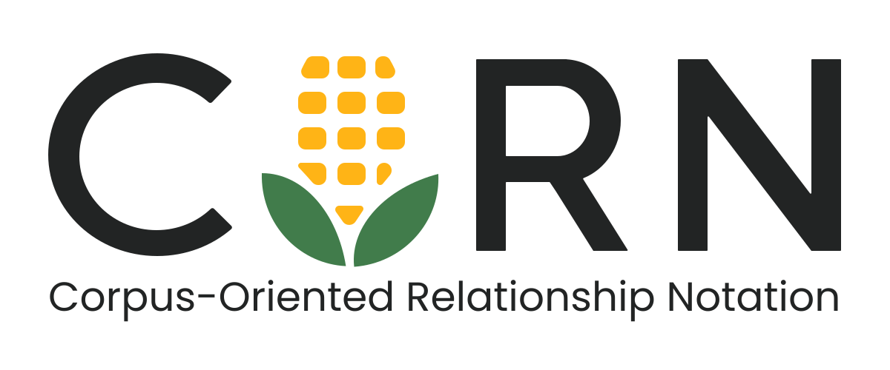
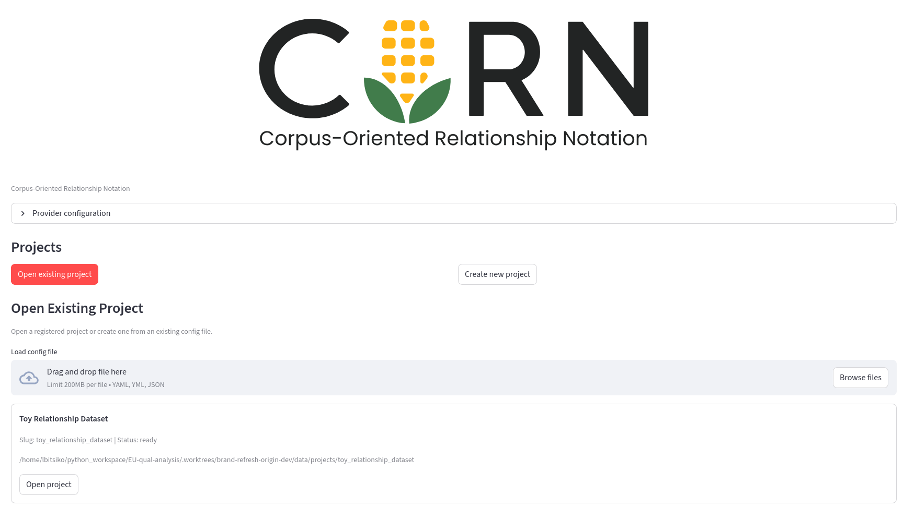
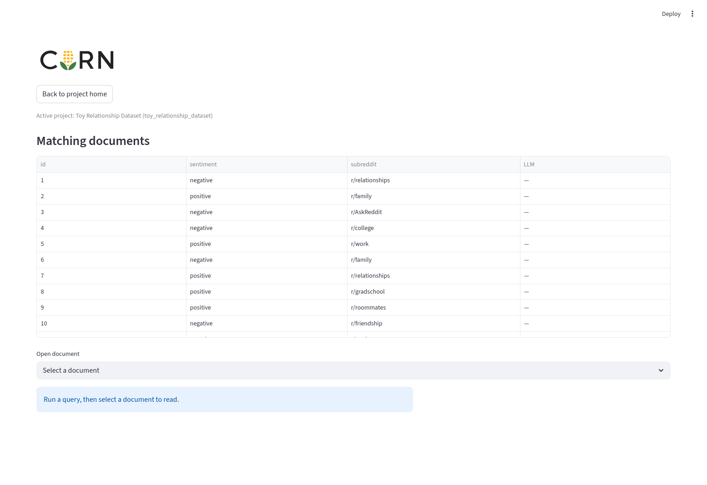
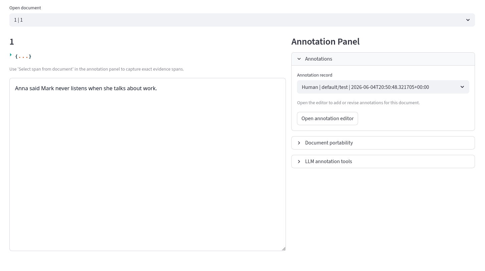
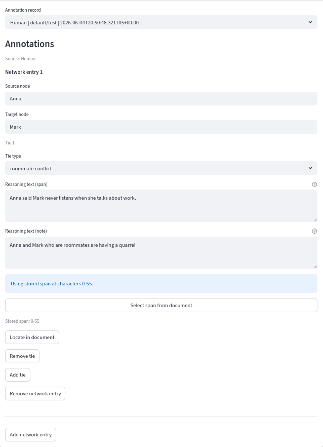
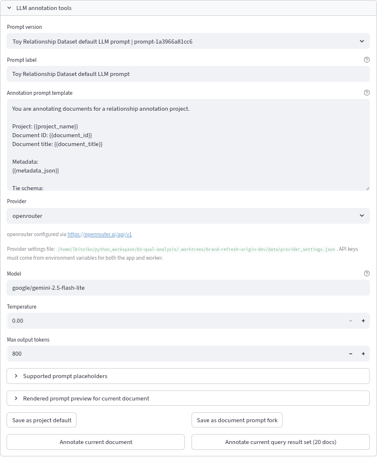
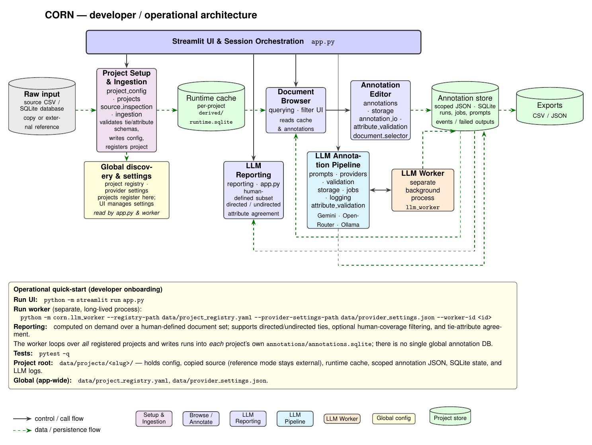

# 🌽 CORN: Corpus-Oriented Relationship Notation

<p align="center">
  
</p>

<p align="center"><strong>Corpus-Oriented Relationship Notation Software</strong></p>

CORN is a project-driven annotation application for reviewing documents, marking evidence spans, building relationship annotations, exporting structured data, and optionally running LLM-assisted annotation jobs. It is implemented as a Streamlit UI backed by project-local configuration, runtime SQLite caches, annotation JSON files, annotation indexes, a pairwise LLM-reporting workflow, and a separate worker process for queued LLM jobs.

## What The Software Does

CORN supports these major operations:

- creates projects from CSV or SQLite sources through guided setup or config files
- normalizes source data into a project-local runtime database for querying
- renders filterable document views from project metadata
- lets annotators create node-to-node relationship entries with exact span evidence and free-text notes
- stores human and LLM-derived annotations in project-local JSON plus SQLite indexes
- exports annotations as edge-list CSV and JSON archives
- queues LLM jobs for the current document or current query result set through Google Gemini, OpenRouter, or Ollama
- compares one human annotation scope against one provider/model LLM scope with pairwise precision/recall/F1 reporting

## Installation

### Portable desktop release

Portable archives run CORN without a separate Python installation. Download the archive matching your platform from the GitHub Releases page:

- Windows x64: `CORN-windows-x64.zip`
- macOS Apple Silicon: `CORN-macos-arm64.zip`
- Linux x64: `CORN-linux-x64.tar.gz`

Verify the adjacent SHA-256 checksum, extract the complete archive, and launch `CORN`. The launcher starts the Streamlit UI and LLM worker, waits until the local service is healthy, and opens the default browser. Keep the launcher open while using CORN.

Portable releases store projects and annotations in the operating system's user-data directory rather than the extracted application folder. A fresh workspace is empty; select **Install demo project** on the home screen to add the optional synthetic example.

The initial archives are unsigned, so Windows SmartScreen or macOS Gatekeeper may request explicit approval. See [Portable CORN Distribution](docs/portable-distribution.md) for download verification, platform-specific launch steps, data locations, API-key setup, troubleshooting, and release limitations.

### Single-user source setup

Requirements:

- Python `3.11+`
- local clone of this repository
- optional for LLM use:
  - Google Gemini or OpenRouter API key
  - or a reachable Ollama server

Install and run:

```bash
git clone https://github.com/lbitsiko/corn.git
cd corn
python -m venv .venv
source .venv/bin/activate
pip install -r requirements.txt
python -m streamlit run app.py
```

The app will usually be available at `http://localhost:8501`.

If you want to use LLM jobs, start the worker in a second terminal:

```bash
source .venv/bin/activate
python -m corn.llm_worker \
  --registry-path data/project_registry.yaml \
  --provider-settings-path data/provider_settings.json \
  --worker-id worker-1
```

### Server-style setup

For shared or server-based deployments, run the UI and the worker as separate long-lived processes from the same checkout and data directory.

UI process:

```bash
source .venv/bin/activate
python -m streamlit run app.py --server.address 0.0.0.0 --server.port 8501
```

Worker process:

```bash
source .venv/bin/activate
python -m corn.llm_worker \
  --registry-path data/project_registry.yaml \
  --provider-settings-path data/provider_settings.json \
  --worker-id worker-1
```

### LLM credentials

Provider base URLs can be configured in the app. API keys are better provided via environment variables so both the Streamlit process and the worker can see them. The Gemini integration uses Google's [Interactions REST API](https://ai.google.dev/gemini-api/docs/get-started#rest) in stateless mode and requests output matching CORN's annotation JSON schema.

Example for Google Gemini (create a key in [Google AI Studio](https://aistudio.google.com/app/apikey)). The model field accepts an exact Gemini model identifier, including future models that support the Interactions API and structured output. Choose an available identifier from Google's [Gemini models catalog](https://ai.google.dev/gemini-api/docs/models):

```bash
export GEMINI_API_KEY="your-gemini-key"
python -m streamlit run app.py
```

OpenRouter uses the same pattern with `OPENROUTER_API_KEY`. Set the selected provider's key in the worker environment too:

```bash
export GEMINI_API_KEY="your-gemini-key"
python -m corn.llm_worker \
  --registry-path data/project_registry.yaml \
  --provider-settings-path data/provider_settings.json \
  --worker-id worker-1
```

Optional environment variables:

- `GEMINI_BASE_URL` (defaults to `https://generativelanguage.googleapis.com/v1beta`)
- `OPENROUTER_BASE_URL`
- `OPENROUTER_HTTP_REFERER`
- `OPENROUTER_X_TITLE`
- `OLLAMA_BASE_URL`
- `OLLAMA_API_KEY`

For local Ollama, the usual base URL is `http://localhost:11434/api`.

## Project Model

Each project lives under `data/projects/<slug>/`:

```text
data/projects/<slug>/
├── annotations/
│   ├── annotations.sqlite
│   └── <workspace_id>/<annotator_id>/<doc_id>.json
├── derived/
│   ├── cache_metadata.json
│   └── runtime.sqlite
├── project.yaml
└── source/
```

The global registry is stored at `data/project_registry.yaml`. The registry is only for discovery and lifecycle operations. The project directory is the source of truth.

Supported source types:

- `csv`
- `sqlite`

Supported source modes:

- `copy`
- `reference`

SQLite projects require `table_or_view`.

### Guided project setup

The guided wizard can inspect a CSV or SQLite source and configure document
fields, metadata filters, tie labels, and optional tie attributes. Tie
attributes are defined once for the project and can then be set independently
on each annotated tie.

The wizard supports the same three attribute types as uploaded project configs:

- `categorical` with user-defined options
- `numeric` with user-defined minimum and maximum bounds
- `temporal` with ISO-partial start and optional end values

Attribute names and descriptions are project-defined; fields such as `valence`,
`strength`, or `period` are examples rather than global defaults. Projects that
do not need tie attributes can leave the optional wizard step empty.

## Annotation Workflow

1. Open an existing project or create one through guided setup or config upload.
2. Build the project cache if the project is new or stale.
3. Choose a workspace and annotator scope.
4. Run a query from the project-defined filters.
5. Open a matching document.
6. Create or edit relationship entries using:
   - `Source node`
   - `Target node`
   - tie label
   - `Reasoning text (span)`
   - `Reasoning text (note)`
7. Save the pending annotations.
8. Export the current scope or import/export a single document annotation if needed.
9. Optionally review or duplicate LLM-derived annotations into the human editor.

### Screenshots

Home / startup:



Query results:



Document view:



Annotation editor and AI Annotation Editor:

<div style="display:flex; gap:12px; align-items:flex-start;">
  
  
</div>

## Annotation Payload Shape

```json
{
  "workspace_id": "project-alpha",
  "annotator_id": "researcher-01",
  "annotation_source": "human",
  "document_id": "doc-1",
  "created_at": "2026-05-27T10:00:00+00:00",
  "updated_at": "2026-05-27T11:15:00+00:00",
  "network_data": [
    {
      "source": "Node A",
      "target": "Node B",
      "ties": [
        {
          "type": "Policy",
          "reasoning_text": "selected evidence from the document",
          "reasoning_text_span": "selected evidence from the document",
          "reasoning_text_note": "",
          "reasoning_start": 123,
          "reasoning_end": 167
        }
      ]
    }
  ]
}
```

Important behavior:

- annotations are project-local
- saved JSON files are scoped by `workspace_id` and `annotator_id`
- a project-local SQLite index mirrors JSON payloads for filtering and export
- exact span resolution is encouraged, but note-only evidence can still be saved
- LLM annotations are stored separately and can be duplicated into the human editor

## LLM Reporting

The project view includes an `LLM reporting` panel for evaluating one human
annotation scope against one LLM scope.

Reporting behavior:

- the human side is selected as one `(workspace_id, annotator_id)` scope
- the LLM side is selected as one `(provider_id, model_id)` scope
- the LLM comparison uses the latest valid run per document for that
  provider/model
- scoring operates on deduplicated `(source, target, tie_label)` tuples per
  document
- evaluation is anchored to the selected human scope; LLM-only documents outside
  that human evaluation set are ignored
- by default, human-annotated documents without a valid LLM run remain in scope
  and lower recall; an optional coverage control can exclude them
- relationships can be evaluated as directed or undirected
- the report includes overall precision, recall, F1, macro F1, per-label
  metrics, a confusion matrix with an explicit `none` class, and attribute
  agreement for projects that define tie attributes

Current limits:

- reports are computed on demand in the UI
- report artifacts are not persisted or exported
- reporting scopes are provider/model based rather than job-specific

## Export And Portability

Workspace-level exports support:

- `All annotations`
- `Human annotations`
- `LLM annotations`
- `Human-from-LLM annotations`

Export formats:

- flat edge-list CSV
- JSON ZIP archive

Document-level portability supports:

- export of the current document annotation as JSON
- import of a document annotation JSON into the active project

Imports are validated strictly:

- the target project must contain the document ID
- imported tie labels must exist in the target project schema
- imported tie attributes must be valid against the target project
  `tie_attribute_schema`
- conflict mode must be `replace` or `abort`

Imported payloads are stored verbatim: attribute values are validated but not
rewritten.

## Configuration Shape

Project configs can be YAML or JSON and include:

- `project`
  - `name`
  - `slug`
- `source`
  - `type`
  - `mode`
  - `path`
  - `table_or_view` for SQLite sources
- `document`
  - `id_field`
  - `text_field`
  - optional `title_field`
- `metadata_fields`
- `filters`
- `tie_schema`
- optional `tie_attribute_schema`

A sample config is available at `data/toy-project.yaml`.

### Tie Attribute Schema

Projects can define per-tie attributes with `tie_attribute_schema`:

```yaml
tie_attribute_schema:
  - name: valence
    type: categorical
    description: Whether the interaction is positive or negative
    options: [positive, negative]
  - name: sentiment
    type: numeric
    description: Sentiment intensity of the tie
    range: [0, 1]
  - name: time
    type: temporal
    description: When the interaction occurred
```

Supported attribute types:

- `categorical`
  - requires a non-empty `options` list
  - `"(unset)"` is reserved as the editor's no-value sentinel and cannot be an
    option
- `numeric`
  - requires a `range` of `[min, max]`
- `temporal`
  - values are objects with a `start` and optional `end`
  - dates are ISO-partial strings: `YYYY`, `YYYY-MM`, or `YYYY-MM-DD`
  - `end` must not precede `start`; mixed-granularity periods compare strictly
    (e.g. end `2019` is rejected against start `2019-07`)

Attribute behavior:

- every attribute is optional per tie; an unset attribute is simply absent from
  the saved payload
- values are validated against the schema on human save, on LLM output
  validation, and on document import
- the LLM prompt advertises the configured attributes automatically, so prompt
  templates do not need to be edited
- the LLM reporting panel adds an attribute agreement section computed over
  matched ties; metrics show `n/a` when the matched ties have no overlapping
  attribute data

## Architecture

The diagram below doubles as a developer/operational map: the left-to-right data
flow, the per-project stores, the standalone LLM worker process, and the run
commands for onboarding. See [docs/architecture.md](docs/architecture.md) for the
detailed write-up, and [docs/architecture-flowchart-dev.tex](docs/architecture-flowchart-dev.tex)
for the source. Regenerate its tracked PDF and README PNG from `docs/` with:

```bash
pdflatex architecture-flowchart-dev.tex
pdftoppm -png -r 150 -singlefile \
  architecture-flowchart-dev.pdf architecture-flowchart-dev
```



## Code Structure

Core modules:

- `app.py`
  - Streamlit entrypoint and workflow orchestration
- `corn/project_config.py`
  - config validation and loading
- `corn/projects.py`
  - project bootstrap, cache build, project status
- `corn/source_inspection.py`
  - guided setup source inspection
- `corn/ingestion.py`
  - runtime database normalization from CSV/SQLite
- `corn/querying.py`
  - project-scoped filtering and document retrieval
- `corn/annotations.py`
  - annotation validation, span helpers, payload logic
- `corn/attribute_validation.py`
  - shared categorical, numeric, and temporal tie-attribute validation
- `corn/storage.py`
  - annotation index and export helpers
- `corn/annotation_io.py`
  - document-level import/export
- `corn/llm_prompts.py`
  - supported prompt placeholders and prompt rendering
- `corn/llm_providers.py`
  - provider adapters and model discovery
- `corn/llm_validation.py`
  - LLM output validation and transformation to annotation payloads
- `corn/llm_storage.py`
  - LLM prompt/job/run persistence
- `corn/reporting.py`
  - pairwise human-vs-LLM reporting metrics and confusion-matrix generation
- `corn/llm_jobs.py`
  - queued LLM execution logic
- `corn/llm_logging.py`
  - structured event logging for LLM jobs
- `corn/llm_worker.py`
  - worker process entrypoint
- `corn/provider_settings.py`
  - provider settings load/save helpers
- `corn/registry.py`
  - project registry load/save and lifecycle helpers
- `corn/utils.py`
  - shared utilities
- `corn/components/document_selector/`
  - custom text-selection component

## Developer Documentation

Additional documentation:

- [docs/architecture.md](docs/architecture.md)
- [docs/developer-guide.md](docs/developer-guide.md)
- [docs/documentation-report.md](docs/documentation-report.md)
- [docs/architecture-flowchart-dev.tex](docs/architecture-flowchart-dev.tex) — developer/operational flow chart (TikZ source)
- [docs/architecture-flowchart.tex](docs/architecture-flowchart.tex) — high-level flow chart (TikZ source)

## Verification

Run the full test suite with:

```bash
pytest -q
```

For local Ollama validation:

```bash
ollama list
```
