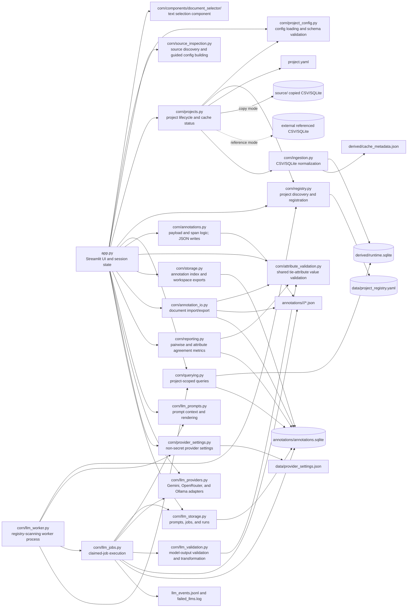

# CORN Architecture

This document maps CORN's current runtime components and follows data through project setup, querying, human and LLM annotation, portability, and reporting.

## High-level structure

CORN has four major layers:

1. Streamlit UI and session orchestration in `app.py`
2. backend modules under `corn/`
3. project-local configuration, caches, annotations, and LLM state
4. an optional worker process that executes queued LLM jobs

The UI and worker are separate processes, but they share the same project registry, provider settings, project directories, and project-local SQLite databases.

## Portable desktop boundary

The portable distribution wraps the existing architecture rather than replacing it. A small launcher supervises the Streamlit UI and LLM worker as separate child processes, waits for the loopback-only UI health endpoint, and opens the user's default browser. The same source modules and project formats remain in use.

Development runs continue to use repository resources and `data/`. A packaged build separates read-only application resources from mutable state: the launcher sets `CORN_DATA_DIR` to a platform-specific user-data directory shared by the UI and worker. Registries, projects, annotations, provider settings, and logs therefore survive replacement of the extracted application folder.

PyInstaller `onedir` bundles are built natively for Windows x64, macOS Apple Silicon, and Linux x64. Real project data and credentials are excluded. See [ADR 0001](adr/0001-portable-desktop-boundary.md) for the accepted constraints and deferred work.

## Persistent artifacts

### App-wide state

- `data/project_registry.yaml`
  - discovers active and archived projects and their project paths
- `data/provider_settings.json`
  - stores non-secret provider settings such as base URLs
  - API keys remain in process environment variables

### Project-local state

Each project normally lives under `data/projects/<slug>/` and contains:

- `project.yaml`
  - normalized source, document, metadata, filter, tie, and tie-attribute schemas
- `source/`
  - contains a copied CSV or SQLite source when `source.mode` is `copy`
  - remains empty when `source.mode` is `reference`; in that mode, `project.yaml` points to the external source path
- `derived/runtime.sqlite`
  - normalized document cache used by querying and document retrieval
- `derived/cache_metadata.json`
  - source size and modification-time snapshot used for stale-cache detection
- `annotations/<workspace>/<annotator>/<document>.json`
  - human, human-from-LLM, and auto-saved LLM annotation payloads
- `annotations/annotations.sqlite`
  - annotation index plus LLM prompts, project settings, jobs, job documents, and runs
- `annotations/llm_events.jsonl`
  - structured worker events when logging is enabled
- `annotations/failed_llms.log`
  - failed provider outputs retained for diagnosis

## Component map

## Critical flows

### 1. Project setup

1. The UI accepts an uploaded config or builds one through the guided wizard.
2. `corn/source_inspection.py` discovers CSV columns or SQLite tables and builds the guided configuration, including optional tie attributes.
3. `corn/project_config.py` validates and normalizes the complete configuration.
4. `corn/projects.py` creates the project layout, copies the source or preserves its external reference, builds the runtime cache, and registers the project.
5. `corn/ingestion.py` normalizes configured source fields into `derived/runtime.sqlite` and records cache metadata.

### 2. Query and document selection

1. The UI loads the active project config and runtime paths.
2. `corn/querying.py` translates configured filters into parameterized SQLite queries.
3. Query results come from `derived/runtime.sqlite`; annotation and LLM coverage checks use `annotations.sqlite`.
4. The custom document selector renders the document and returns selected evidence spans.

### 3. Human annotation

1. The UI loads one annotation record into document-specific session state.
2. `corn/annotations.py` normalizes network entries and validates evidence spans or note-only evidence.
3. `corn/attribute_validation.py` validates configured categorical, numeric, and temporal values.
4. Saving writes a scoped JSON payload through `corn.annotations.save_annotation` and mirrors it into `annotations.sqlite` through `corn.storage.save_annotation_record`.
5. Workspace exports read the SQLite index and produce edge-list CSV or a ZIP of JSON payloads.

### 4. Document portability

1. `corn/annotation_io.py` verifies that the target document exists.
2. It rejects unknown tie labels and attributes that do not satisfy the target project's schema.
3. Valid imports are stored verbatim in scoped JSON and indexed in SQLite.
4. Conflict mode determines whether an existing scoped record is replaced or preserved.

### 5. LLM annotation

1. The UI creates or forks a project-local prompt and queues a job for the current document or current query result set.
2. `corn/llm_worker.py` scans non-archived projects and claims one available job at a time.
3. `corn/llm_prompts.py` renders document metadata, tie schemas, tie-attribute schemas, and the expected annotation shape.
4. `corn/llm_providers.py` sends a request to Gemini's Interactions API, OpenRouter, or Ollama.
5. `corn/llm_validation.py` checks the intermediate response, validates tie labels and attributes, resolves evidence spans when possible, and transforms valid output into the canonical payload.
6. `corn/llm_jobs.py` persists valid, invalid, and failed runs. Valid runs are also auto-saved as read-only LLM annotation JSON and indexed in the annotation table.
7. Provider failures and raw outputs are retained in project-local run records and failure logs for diagnosis.

### 6. LLM reporting

1. The user selects one human `(workspace_id, annotator_id)` scope and one LLM `(provider_id, model_id)` scope.
2. The LLM side uses the latest valid run per document for that provider and model.
3. The human scope defines the evaluation population. LLM-only documents outside that population are ignored.
4. By default, human documents without valid LLM runs remain in the evaluation and reduce recall. The UI can instead exclude those documents.
5. Relationships can be treated as directed or undirected.
6. `corn/reporting.py` compares deduplicated `(source, target, tie_label)` tuples and computes overall and per-label metrics plus a confusion matrix.
7. For projects with tie attributes, it computes coverage and type-specific agreement over matched ties: categorical accuracy, numeric error/tolerance, and temporal agreement at common granularity.
8. Reports are computed on demand and are not persisted as separate artifacts.

## Validation boundaries

Tie-attribute definitions are project-wide, while values are optional per tie. The fixed types are categorical, numeric, and temporal; names, descriptions, options, and numeric ranges are project-defined.

The shared value validator is used at the principal write and comparison boundaries:

- human annotation save
- document annotation import
- LLM intermediate-output validation
- reporting's lenient handling of persisted attribute values

This keeps attribute semantics aligned across human annotation, generated annotation, portability, and evaluation.

## Modularity and constraints

The backend is split by lifecycle concern: configuration, ingestion, querying, annotation, persistence, portability, provider transport, queued execution, and reporting. `app.py` remains the least modular area because it coordinates Streamlit rendering and session state for all workflows.

Operationally, the UI and worker must use the same application resources and writable data directory and must receive compatible provider settings and environment variables. In source mode those resources normally come from one checkout; in portable mode they come from one frozen bundle plus `CORN_DATA_DIR`. A queued job does not progress unless a worker process is running.
